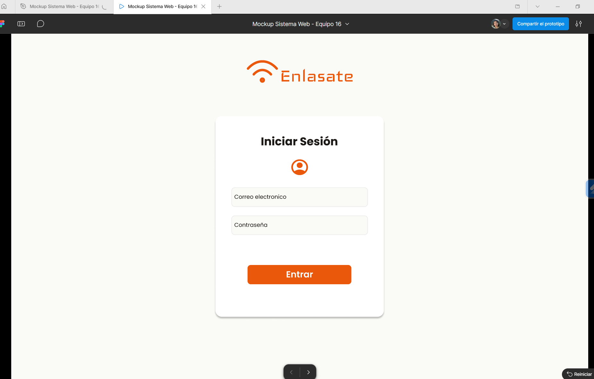
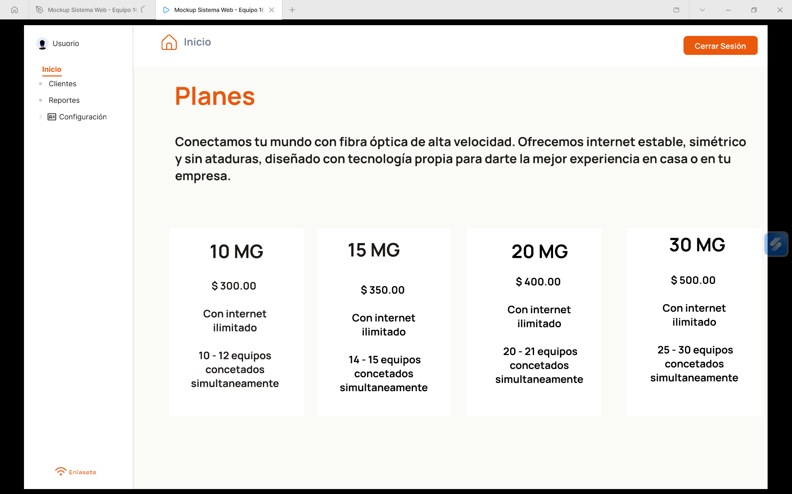
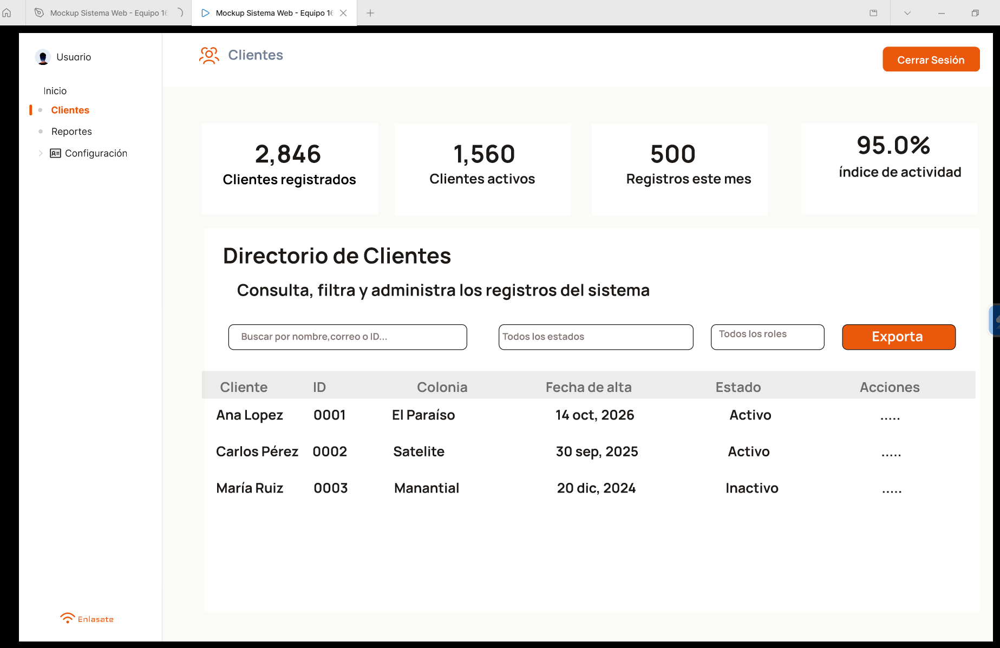
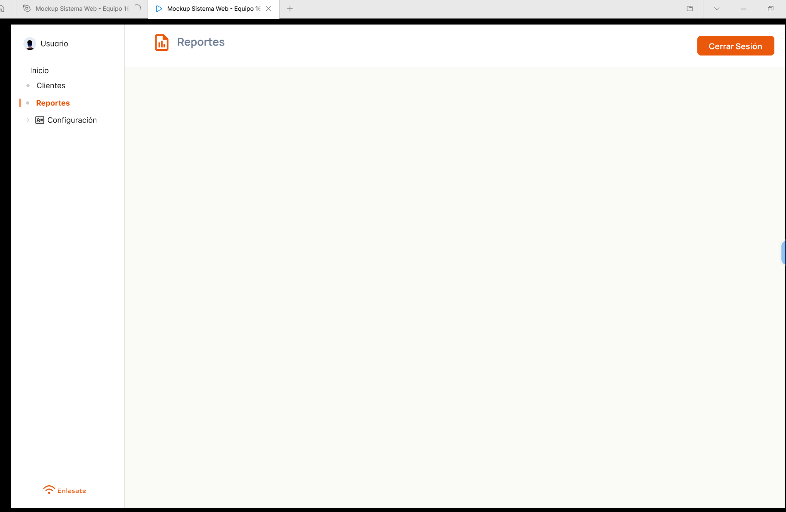
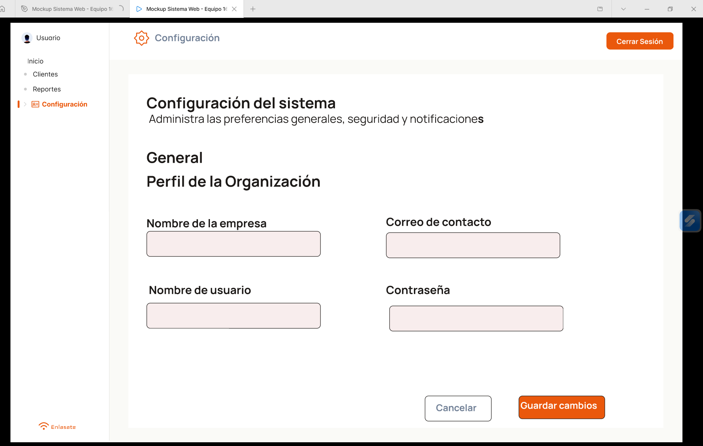

# Sistema de Planes de Internet

Aplicación web desarrollada con React y Vite para la gestión de clientes de una empresa proveedora de servicios de Internet. El sistema permite consultar información, realizar búsquedas, filtrar registros y ejecutar operaciones CRUD mediante una API REST.

## Integrantes

- Martínez Bautista Karla
- Ruiz Jiménez Erandi Camila

## Objetivo del proyecto

Desarrollar una aplicación web que facilite la administración de clientes de una empresa de servicios de Internet mediante una interfaz intuitiva y funcional, incorporando autenticación, búsqueda, filtros, paginación y operaciones para agregar, editar y eliminar registros.

## API seleccionada

**DummyJSON Users**

Documentación: https://dummyjson.com/users

Se seleccionó esta API porque permite simular la gestión de clientes mediante información de usuarios. Sus funcionalidades de búsqueda, paginación y operaciones CRUD se adaptan a los requerimientos del proyecto.

Los datos obtenidos se adaptaron al contexto de una empresa de Internet. Por ejemplo, los campos `firstName` y `lastName` se utilizan para representar el nombre del cliente, mientras que `address.city` permite mostrar su ubicación.

La API también permite realizar solicitudes HTTP para consultar información y simular operaciones de creación, actualización y eliminación de registros.

## Tecnologías utilizadas

| Tecnología | Descripción |
|---|---|
| React | Desarrollo de la interfaz mediante componentes. |
| Vite | Herramienta para el desarrollo y la compilación del proyecto. |
| React Router DOM | Administración de rutas y navegación. |
| Lucide React | Biblioteca de iconos para la interfaz. |
| DummyJSON | API para autenticación y consulta de usuarios. |
| Nginx | Servidor web utilizado para el despliegue. |
| Amazon EC2 | Servicio de alojamiento de la aplicación en la nube. |

## Funcionalidades principales

- Inicio de sesión mediante la API de autenticación de DummyJSON.
- Visualización de información de los clientes.
- Búsqueda de registros mediante texto.
- Aplicación de filtros para organizar la información.
- Paginación de registros y selección de la cantidad de elementos por página.
- Sincronización de la paginación con los parámetros de la URL.
- Registro de nuevos clientes mediante formularios modales.
- Edición de registros con confirmación.
- Eliminación de registros con confirmación.
- Actualización de la interfaz después de realizar operaciones.
- Navegación mediante un menú lateral y una barra superior.

## Operaciones CRUD

El sistema utiliza solicitudes HTTP para simular las operaciones básicas de administración de clientes.

| Método HTTP | Operación | Descripción |
|---|---|---|
| GET | Consultar | Obtiene la información de los usuarios. |
| POST | Crear | Simula el registro de un nuevo usuario. |
| PUT | Actualizar | Simula la modificación de un usuario existente. |
| DELETE | Eliminar | Simula la eliminación de un usuario. |

Las operaciones de escritura de DummyJSON son simuladas por la API y no representan cambios permanentes en una base de datos propia.

## Paginación

La aplicación permite navegar entre páginas y seleccionar la cantidad de registros que se muestran. Para ello, se utilizan parámetros en la URL que permiten conservar la página actual y el tamaño de la página.

Ejemplo:

```text
?page=2&limit=20
```

La API también admite los parámetros `limit` y `skip` para controlar la cantidad de registros devueltos y el desplazamiento de los resultados.

Ejemplo de consulta:

```text
https://dummyjson.com/users?limit=10&skip=0
```

## Instalación y ejecución local

### Requisitos previos

- Node.js.
- npm.
- Git.

### 1. Clonar el repositorio

```bash
git clone https://github.com/Karl335-lm/t3_act8_eq16.git
```

### 2. Acceder al directorio del proyecto

```bash
cd t3_act8_eq16
```

### 3. Instalar las dependencias

```bash
npm install
```

### 4. Ejecutar la aplicación

```bash
npm run dev
```

Una vez iniciado el servidor de desarrollo, Vite mostrará en la terminal la dirección local para acceder a la aplicación desde el navegador.

La dirección predeterminada suele ser:

```text
http://localhost:5173/
```

Si la aplicación se encuentra dentro de una subcarpeta, es necesario acceder primero al directorio que contiene el archivo `package.json`.

## Diseño de la interfaz

Para el diseño visual se tomó como referencia el prototipo elaborado en Figma durante la actividad anterior. Se conservaron elementos como la pantalla de inicio de sesión, el menú lateral, la barra de navegación y la tabla principal de clientes.

La interfaz se organizó mediante componentes reutilizables para facilitar el mantenimiento y la integración de las distintas funcionalidades, a continuación se muuestran diseños realizados en Figma.

>Diseño Login



>Inicio


>Clientes


>Reportes (aún en desarrollo)


>Configuración


## Resumen del desarrollo

### Fases 1 y 2. Autenticación e interfaz principal

Se desarrolló el formulario de inicio de sesión y se integró la API de autenticación de DummyJSON. Se incorporaron validaciones para los campos y el manejo del estado de la sesión.

Posteriormente, se construyó la estructura principal de la aplicación mediante componentes de React, incluyendo el menú lateral y la barra superior. También se implementó el control de acceso a las pantallas según el estado de autenticación.

### Fase 3. Tabla, filtros, paginación y CRUD

Se conectó la tabla con la API de usuarios para mostrar la información de los clientes. Se implementaron la búsqueda por texto, los filtros y la paginación mediante parámetros en la URL.

También se desarrollaron formularios modales para agregar y editar registros, así como mecanismos de confirmación antes de modificar o eliminar información. Finalmente, se incorporó la actualización de la interfaz después de realizar las operaciones.

### Fase 4. Despliegue

La aplicación se desplegó en una instancia EC2 de Amazon Web Services utilizando Amazon Linux y Nginx.

El proceso incluyó la generación de los archivos de producción mediante Vite, la transferencia de la carpeta `dist` al servidor y la configuración de Nginx para publicar la aplicación en la ruta correspondiente.

## Proyecto desplegado

La aplicación se encuentra alojada en una instancia EC2 de Amazon Web Services.

**Enlace de acceso:** http://18.218.44.223/t3_act8_eq16/

El acceso depende de que la instancia esté activa y de que el servidor y las reglas de red estén configurados correctamente.

## Aprendizajes obtenidos

Durante el desarrollo del proyecto se reforzaron los conocimientos relacionados con:

- Desarrollo de interfaces con React.
- Creación y reutilización de componentes.
- Manejo del estado mediante `useState`.
- Consumo de API REST.
- Implementación de formularios y validaciones.
- Búsqueda, filtros y paginación.
- Administración de rutas y parámetros de URL.
- Implementación de operaciones CRUD.
- Compilación de aplicaciones con Vite.
- Despliegue de aplicaciones web en AWS EC2 mediante Nginx.